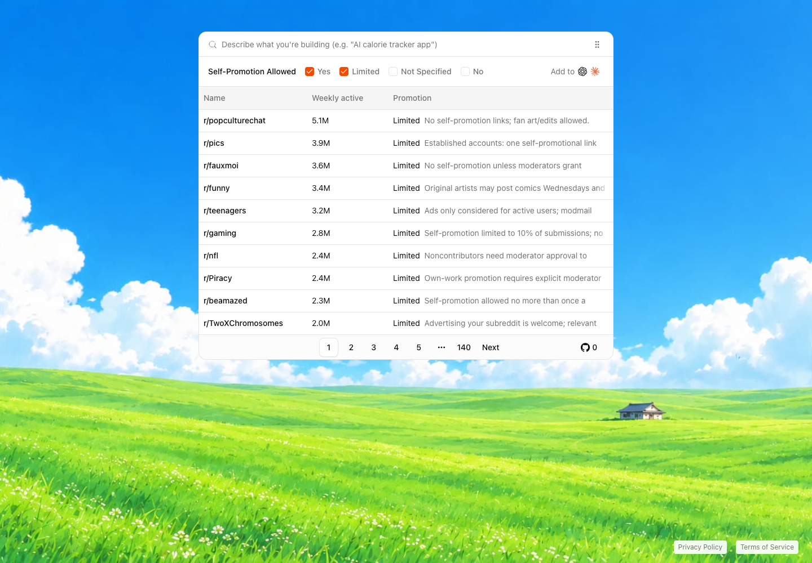

<p align="center">
  
</p>

<p align="center"><a href="https://www.promotercat.com/?utm_source=github&amp;utm_medium=readme&amp;utm_campaign=promotercat">PromoterCat</a> helps you find subreddits where you can promote your product for free.</p>



## Running locally

Copy `.env.example` to `.env.local` and fill in the values. Use `pnpm dev:local`
to start the local database and app. Docker must be running.

The local CLI commands also load `.env.local`:

```sh
pnpm subreddits:local add --url https://www.reddit.com/r/opensource/
pnpm evals:local
```

## Doppler (optional)

Doppler is optional. The `dev` and `evals` commands load the `web/dev` config
from Doppler. The `subreddits` command uses Doppler when you select `--env dev`
or `--env prod`. Use the `:local` commands above to load values from
`.env.local` instead.

## Commands

| Command | Description |
| --- | --- |
| `pnpm dev` | Start Supabase, then run the app with Doppler's `web/dev` config. |
| `pnpm dev:local` | Start Supabase, then run the app using `.env.local`. |
| `pnpm build` | Build the app for production. |
| `pnpm start` | Run the production build. |
| `pnpm lint` | Check the project with Biome. |
| `pnpm format` | Format files with Biome. |
| `pnpm generate-types` | Generate TypeScript types from the local Supabase database. |
| `pnpm supabase` | Run a Supabase CLI command. |
| `pnpm db:start` | Start the local Supabase services. |
| `pnpm db:stop` | Stop the local Supabase services. |
| `pnpm db:reset` | Reset the local database and apply migrations and seed data. |
| `pnpm db:status` | Show local Supabase service status and connection details. |
| `pnpm subreddits add --env dev\|prod ...` | Run the subreddit CLI with the selected Doppler config. |
| `pnpm subreddits:local ...` | Run the subreddit CLI using `.env.local`. |
| `pnpm evals` | Run evaluations with Doppler's `web/dev` config. |
| `pnpm evals:local` | Run evaluations using `.env.local`. |
| `pnpm plugin:version` | Print the plugin version. |

## License

[MIT](LICENSE)
